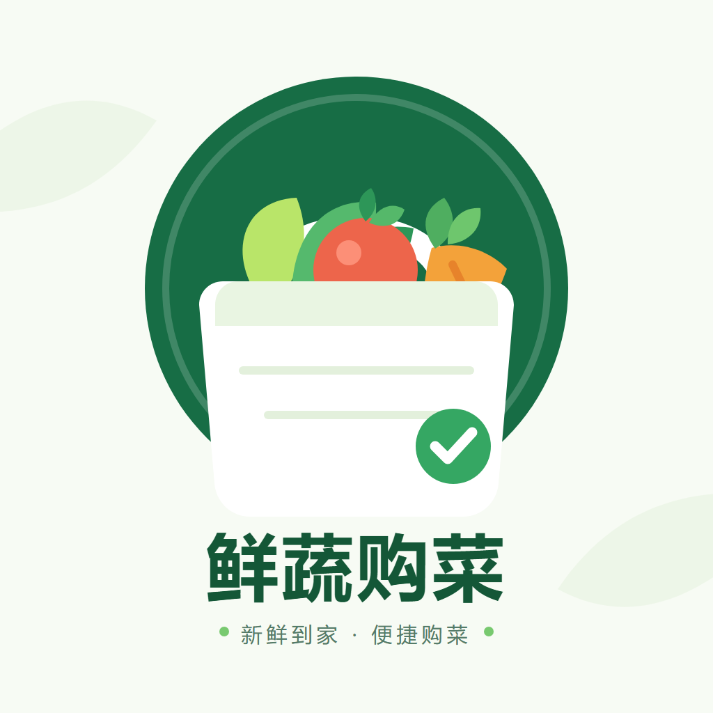
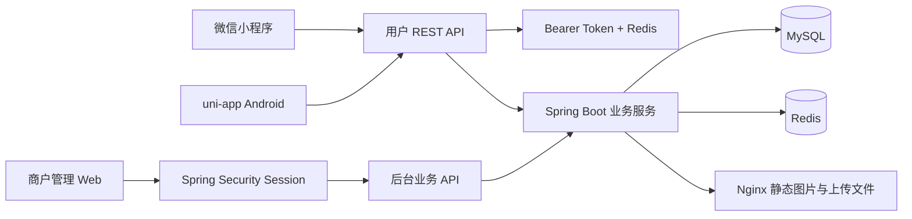

  

# 菜贩管理系统与鲜蔬购菜客户端

面向生鲜采购、库存、销售、分拣、配送和顾客购菜场景的全栈项目。后端使用 Spring Boot 构建 REST API，顾客端包含微信小程序和 uni-app Android App，商户端使用服务端 Web 管理后台。

> 本仓库是经过脱敏的公开代码展示版，不是可直接部署的生产仓库。数据库数据、服务器配置、部署脚本、测试账号和构建产物均已移除。

## 技术栈

## 项目亮点

- 后端按 `common / system / business / admin` 拆分模块，用户 App API 与商户后台 Web 隔离鉴权。
- 微信小程序和 Android App 共用 `/api/mall/**` Bearer Token API，Redis 保存登录令牌并限制同账号并发登录。
- 实现采购、入库、库存批次、FIFO 成本、销售、取消退款、分拣配送、客户签收和月度对账。
- 拼单支持多菜品、数量或重量、促销价、运费规则、成员退出、失效时间和历史价格快照。
- 订单取消会回补库存批次、释放赊账额度并记录退款原因。
- 使用 Apache POI 导出顾客对账单和销售备货 Excel。
- 菜品图自动生成 `480×480` JPEG 缩略图，实测图片总量降低约 `93.3%`，并支持 Nginx 长期缓存。
- 后端维护 28 个自动化测试，覆盖财务、拼单、订单取消、图片缩略图和 Excel 文案。

## 系统架构

更完整的模块、数据流和认证说明见 [架构说明](docs/architecture.md)。

## 业务模块

| 模块 | 主要能力 |
| --- | --- |
| 用户与认证 | 散客/采购商注册、审核状态、登录令牌、单账号互斥 |
| 菜品与库存 | 菜品、品类、供应商、图片、库存汇总、批次与盘点 |
| 采购与销售 | 采购入库、FIFO 库存扣减、应收应付、取消与退款 |
| 分拣配送 | 待分拣、分拣中、已分拣、已配送、已签收 |
| 拼单促销 | 多菜品拼单、成员加入/退出、活动价、运费和每日配置 |
| 顾客移动端 | 选购、购物车、地址、支付、订单、签收、损耗报备 |
| 报表 | 日结、月报、顾客月度对账、Excel 导出 |

## 代码导览

| 招聘方关注点 | 推荐入口 |
| --- | --- |
| Bearer Token 与 Redis 登录态 | [MallTokenService.java](code-snapshots/backend/auth/MallTokenService.java) |
| 用户 API 鉴权拦截 | [MallAuthInterceptor.java](code-snapshots/backend/auth/MallAuthInterceptor.java) |
| 登录、注册和退出接口 | [MallAuthController.java](code-snapshots/backend/controller/MallAuthController.java) |
| 顾客业务 API | [MallApiController.java](code-snapshots/backend/controller/MallApiController.java) |
| 订单取消与库存回补 | [OrderCancellationService.java](code-snapshots/backend/service/OrderCancellationService.java) |
| 菜品缩略图生成 | [GoodsThumbnailService.java](code-snapshots/backend/service/GoodsThumbnailService.java) |
| Excel 导出 | [StatementExcelWriter.java](code-snapshots/backend/support/StatementExcelWriter.java) |
| 接口安全测试 | [UserChannelAccessTest.java](code-snapshots/backend/test/UserChannelAccessTest.java) |
| 微信小程序选购与购物车 | [miniprogram/pages/index](code-snapshots/miniprogram/pages/index) |
| Android 选购页 | [android/pages/index/index.vue](code-snapshots/android/pages/index/index.vue) |
| Android 拼单页 | [android/pages/groups/index.vue](code-snapshots/android/pages/groups/index.vue) |

详细阅读顺序见 [代码导览](docs/code-tour.md)。

## 工程实践

- 金额使用 `BigDecimal`，避免浮点误差。
- 库存和财务操作使用事务，取消订单保留批次分配记录用于逆向回补。
- Long 类型雪花 ID 序列化为字符串，避免前端精度丢失。
- 用户端与管理端采用不同认证体系，减少 Session 与 Token 混用。
- 配置通过环境变量注入，代码仓库不保存生产密码。
- 重要变更同步更新 README、SQL 迁移、自动化测试和部署验收说明。

更多实现说明见 [工程亮点](docs/engineering-highlights.md)。

## 脱敏说明

公开仓库只保留展示所需代码和文档，已移除：

- 服务器 IP、域名和登录信息
- 数据库密码、Token、证书和测试账号
- 生产部署脚本与环境变量
- 完整数据库数据、顾客订单和个人信息
- APK、JAR 和运行日志

详见 [脱敏说明](docs/sanitization.md)。

## 面试演示

完整项目仍保存在私有仓库中。面试时可按招聘方需要提供指定模块讲解，或在确认身份后临时添加只读协作者。
