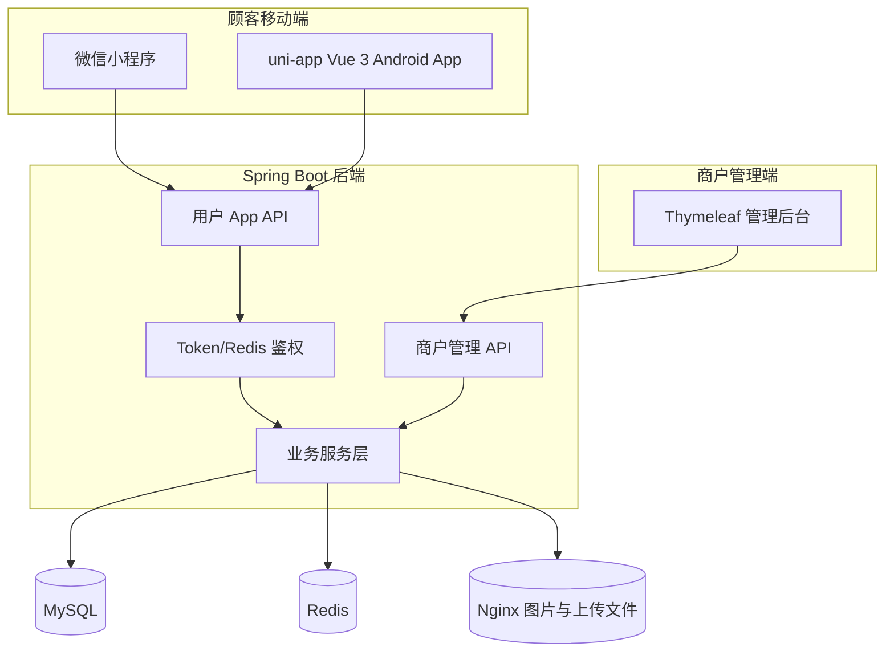

# 系统架构

## 1. 客户端分工

微信小程序和 Android 只通过 Bearer Token API 交互。用户 H5 与 Session 登录链已移除，管理后台继续使用 Spring Security Session。

## 2. 后端模块

| 模块 | 职责 |
| --- | --- |
| `caifan-common` | 统一返回体、异常、基础实体、租户和用户上下文 |
| `caifan-system` | 后台用户、角色、菜单和字典 |
| `caifan-business` | 采购、库存、销售、财务、拼单、配送和报表 |
| `caifan-admin` | 启动入口、安全配置、用户 API、管理后台、上传与导出 |

## 3. 认证流程

1. 小程序或 Android 使用手机号和密码调用登录接口。
2. 后端校验 BCrypt 密码，生成随机 Bearer Token。
3. Token 和当前客户信息写入 Redis，同时记录该客户的活跃 Token。
4. 新登录会覆盖同一客户的活跃标记，旧 Token 随后失效。
5. `MallAuthInterceptor` 解析 `Authorization: Bearer <token>`，将客户信息写入请求上下文。
6. 用户 API 只接受有效 Token；缺失或失效统一返回 HTTP 401。

## 4. 订单与库存

- 销售单创建时记录商品金额、运费、应付金额和支付状态。
- 库存按批次执行 FIFO 扣减，并将批次分配结果保存在订单快照中。
- 取消订单时按快照回补批次、库存汇总和客户赊账额度。
- 退款与取消原因独立记录，避免删除原始订单。

## 5. 拼单与价格

- 一个拼单可以包含多个菜品和各自数量。
- 创建拼单时计算活动价、官方拼单价和运费，并把结果保存为快照。
- 活动结束或后续改价不会修改已经创建的拼单历史价格。
- 成员退出只释放自己的名额，不影响其他成员继续支付。

## 6. 文件与图片

- 菜品原图保存到服务器图片目录。
- 上传时自动生成 `480×480` JPEG 缩略图。
- 应用启动时扫描历史图片并补齐缺失缩略图。
- API 返回 `thumbUrl`，客户端优先加载缩略图，失败后回退原图。
- Nginx 直接响应图片并设置浏览器缓存，减少 Java 转发和重复下载。

## 7. 报表

- 日结和月报使用实时聚合。
- 顾客月度对账单使用购物方口径：应付、已付、未付。
- Excel 导出包含汇总、订单明细和状态字段。
